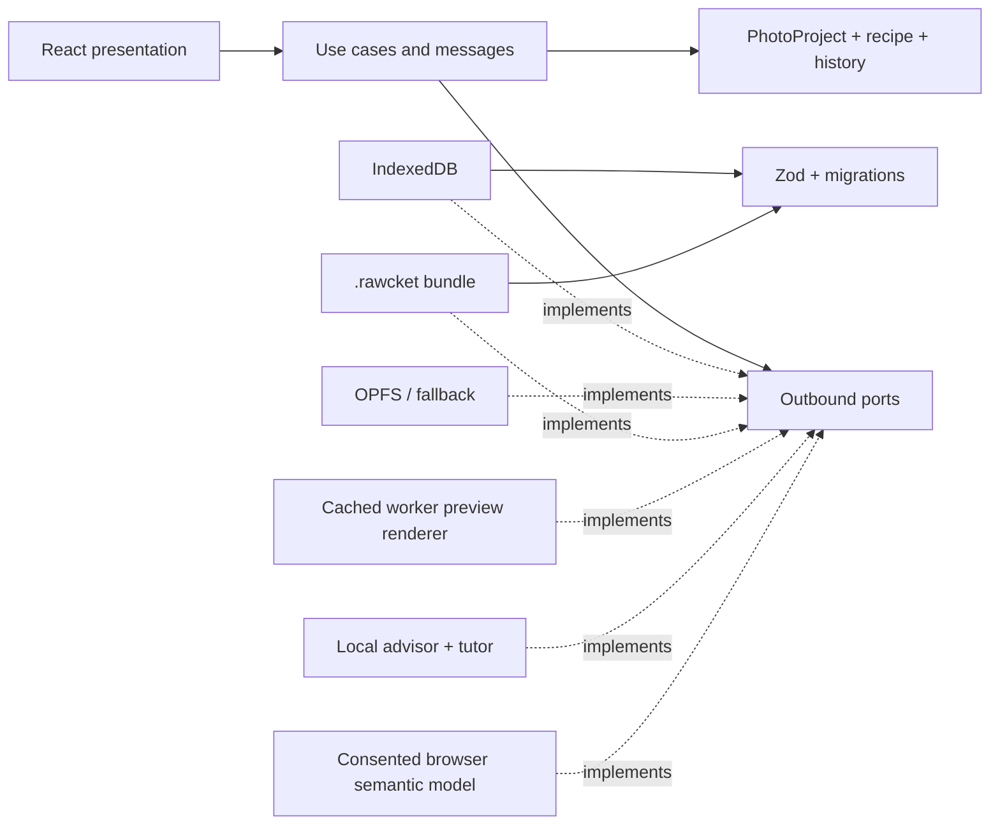
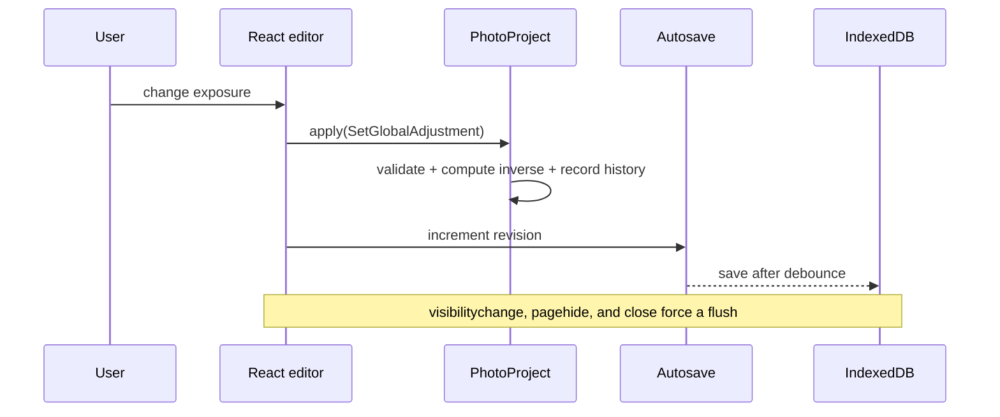

# RAWcket architecture

## Map

Dependency arrows point toward the application and domain layers. The domain depends only on `@haskou/value-objects` and its own concepts.

## Aggregate

`PhotoProject` is the consistency boundary. It owns the name, original reference, project metadata, immutable validated `CaptureMetadata`, `DevelopmentRecipe`, `EditHistory`, and `ProjectUiState`. Every editorial mutation passes through an `EditOperation`; the aggregate computes the inverse before recording history and emits a domain event.

Schema version 4 introduced `ProjectOrganization`: a bounded zero-to-five `ProjectRating` and at most twenty normalized `ProjectTag` values. Schema version 6 adds the favorite decision to the same domain concept and lightweight index. Rating, tag, and favorite changes use serializable history. `PhotoProjectSummary` exposes matching behavior so library filters do not extract and compare primitive domain values.

Schema version 5 adds immutable `CaptureMetadata`. The bounded TIFF reader extracts only validated, size-limited EXIF fields from Sony ARW containers; the aggregate persists those facts separately from editable project state. Missing fields remain explicitly null and the UI distinguishes embedded-preview development from future high-depth RAW demosaicing.

`JsonProjectSidecarCodec` is an infrastructure boundary for recipe-only `.rawcket.json` files. Application messages validate project identity and file size; importing delegates to the aggregate’s `replace-recipe` operation so the entire change is validated, serializable, and undoable without copying source bytes or project identity.

`EditHistory.getTimeline()` returns cloned applied and redo operations. The visual history renders those same operations, so it cannot drift from actual undo/redo state or mutate recorded history through presentation references.

Project/source mutations cross IndexedDB and OPFS, so `projectAssetJournal` records create/delete intent before either store changes. Create, duplicate, bundle import, delete, and startup reconciliation share one FIFO queue. Recovery removes a source only when a persisted create/delete mutation plus the absence of its project proves it is orphaned; referenced originals are never swept heuristically.

`DevelopmentRecipe` contains:

- `GlobalAdjustments`: sixteen adjustments with concept-specific ranges and independent enabled state.
- `CurveSet`: RGB, R, G, B, and optional luminance; normalized points and validated interpolation.
- `ViewportTransform`: a fixed crop frame and reversible original-image transform.
- `MaskDefinition[]`: vector/semantic source definitions; rasters and embeddings are caches, never source of truth.

## Boundaries

- Zod validates JSON and persistence data before `fromPrimitives` hydration.
- Persistence mappers are the normal consumers of complete primitive serialization.
- OPFS is used only behind `SourceFileRepository`; IndexedDB is the fallback.
- `PreviewRenderer` isolates worker and image-pipeline concerns from React and the domain.
- `EditingAdvisor` can return only `EditOperation` proposals and never receives authority to mutate an aggregate.
- `SemanticSegmentationModel` owns the optional model lifecycle and returns only normalized suggestions. `CreateSemanticMask` converts those suggestions into domain-owned, versioned `MaskDefinition` values.
- Portable development settings exclude source identity, geometry, masks, and disposable caches; paste and presets use one reversible aggregate operation.

## Save flow

## Preview flow

`RenderProjectPreview` accepts a validated application message. `CachingPreviewRenderer` keys disposable results by source, recipe, preview size, and cache-format version. `WorkerPreviewRenderer` owns scheduling, cancellation, timeout, and source lookup. The worker decodes JPEG/PNG or an ARW embedded preview into an `OffscreenCanvas`. `WebGpuPixelDeveloper` runs compatible global development and curve LUTs in a compute shader; `WebGl2PixelDeveloper` provides the graphics fallback. Recipes containing masks or spatial texture/sharpen/denoise stages use `CpuPixelDeveloper`. The backend is reported with the histogram so the UI never disguises a fallback. Viewport geometry, RGB/luminance histograms, clipping, and WebP encoding follow development. Final JPEG/PNG/TIFF export reuses the same worker pipeline. Future full GPU-stage and LibRaw adapters must preserve this port contract.

## Persistence recovery

Each save validates the new aggregate and atomically stores the previous valid record as a SHA-256 snapshot. Five snapshots are retained per project. If the current record cannot migrate, validate, or hydrate, the repository searches newest-first for a snapshot whose checksum and schema both pass. It returns that recovery copy without overwriting the corrupt record, preserving forensic and manual recovery options.

## Local semantic model flow

The browser adapter discloses the model source, immutable revision, expected weight size, compatibility-runtime cost, and model-card link before enabling installation. It downloads no weights without a checked consent control. Every resource is fetched without credentials, checked against a pinned size and SHA-256 digest, and only then placed in a dedicated Cache Storage namespace. Transformers.js is configured to resolve only from that verified cache during inference, with remote model loading disabled. WebGPU is attempted first and ONNX Runtime Web/WASM is the fallback. Removal disposes the active pipeline and deletes the dedicated model cache; manual and deterministic point-guided masks do not depend on it.
