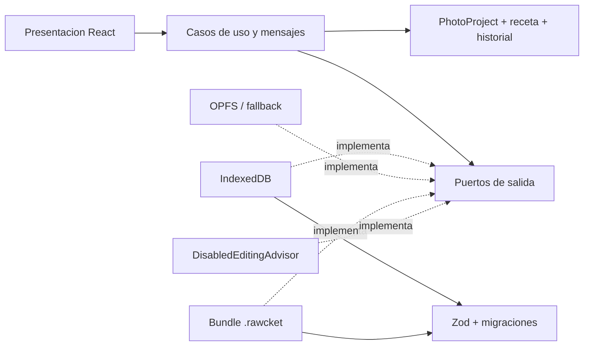
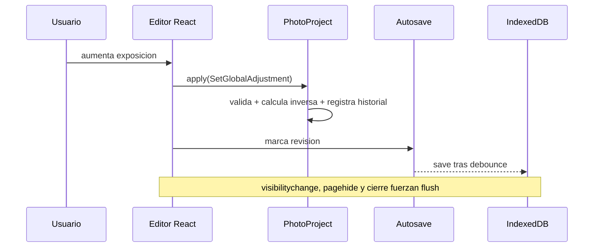

# Arquitectura de RAWcket

## Mapa

Las flechas de dependencia apuntan hacia dominio/aplicacion. El dominio solo depende de `@haskou/value-objects` y conceptos propios.

## Agregado

`PhotoProject` es la frontera de consistencia. Posee nombre, referencia al original, metadata, `DevelopmentRecipe`, `EditHistory` y `ProjectUiState`. Toda mutacion editorial pasa por `EditOperation`; el agregado calcula la inversa antes de registrar el cambio y emite un evento de dominio.

`DevelopmentRecipe` contiene:

- `GlobalAdjustments`: catorce ajustes con rangos por concepto.
- `CurveSet`: RGB, R, G, B y luminancia opcional; puntos 0..1 e interpolacion validada.
- `ViewportTransform`: marco fijo y transformacion reversible del original.
- `MaskDefinition[]`: formas vectoriales/semanticas; raster y embeddings son caches, no verdad.

## Limites

- Zod valida JSON y persistencia antes de `fromPrimitives`.
- Los mappers de persistencia son los unicos consumidores normales de serializacion completa.
- OPFS se usa solo detras de `SourceFileRepository`; IndexedDB es el fallback.
- `PreviewRenderer` es la futura frontera del worker/pipeline. La UI actual no lo suplanta con filtros CSS.
- `EditingAdvisor` solo puede devolver propuestas de `EditOperation`; nunca recibe capacidad de mutar el agregado.

## Flujo de guardado

