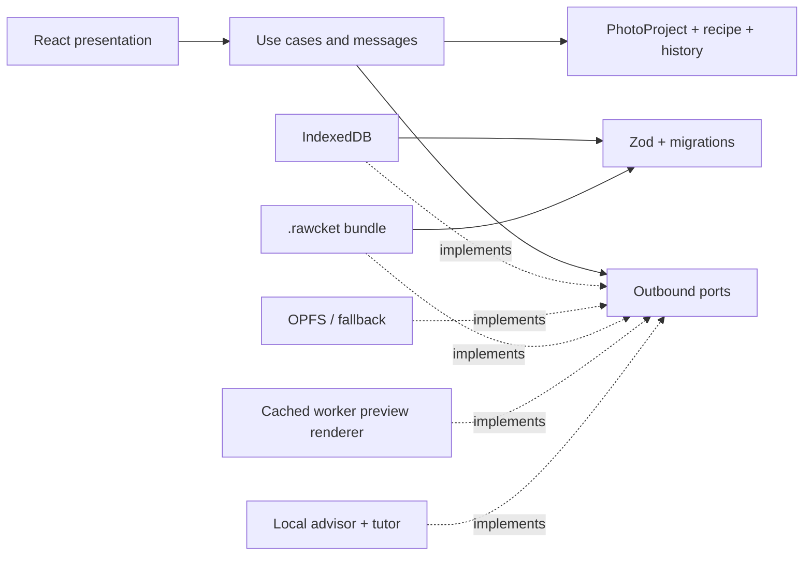
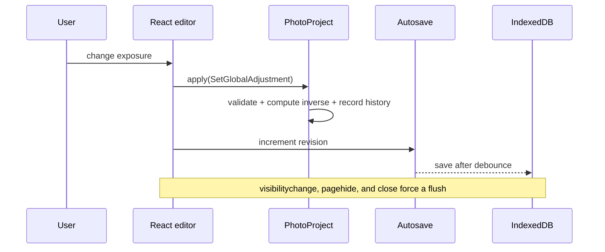

# RAWcket architecture

## Map

Dependency arrows point toward the application and domain layers. The domain depends only on `@haskou/value-objects` and its own concepts.

## Aggregate

`PhotoProject` is the consistency boundary. It owns the name, original reference, metadata, `DevelopmentRecipe`, `EditHistory`, and `ProjectUiState`. Every editorial mutation passes through an `EditOperation`; the aggregate computes the inverse before recording history and emits a domain event.

`DevelopmentRecipe` contains:

- `GlobalAdjustments`: sixteen adjustments with concept-specific ranges and independent enabled state.
- `CurveSet`: RGB, R, G, B, and optional luminance; normalized points and validated interpolation.
- `ViewportTransform`: a fixed crop frame and reversible original-image transform.
- `MaskDefinition[]`: vector/semantic source definitions; rasters and embeddings are caches, never source of truth.

## Boundaries

- Zod validates JSON and persistence data before `fromPrimitives` hydration.
- Persistence mappers are the normal consumers of complete primitive serialization.
- OPFS is used only behind `SourceFileRepository`; IndexedDB is the fallback.
- `PreviewRenderer` isolates worker and image-pipeline concerns from React and the domain.
- `EditingAdvisor` can return only `EditOperation` proposals and never receives authority to mutate an aggregate.
- Portable development settings exclude source identity, geometry, masks, and disposable caches; paste and presets use one reversible aggregate operation.

## Save flow

## Preview flow

`RenderProjectPreview` accepts a validated application message. `CachingPreviewRenderer` keys disposable results by source, recipe, preview size, and cache-format version. `WorkerPreviewRenderer` owns scheduling, cancellation, timeout, and source lookup. The worker decodes JPEG/PNG or an ARW embedded preview into an `OffscreenCanvas`. `WebGl2PixelDeveloper` runs compatible global development and curve LUTs in a fragment shader; recipes containing masks or spatial texture/sharpen/denoise stages use `CpuPixelDeveloper`. The backend is reported with the histogram so the UI never disguises a fallback. Viewport geometry, RGB/luminance histograms, clipping, and WebP encoding follow development. Final JPEG/PNG/TIFF export reuses the same worker pipeline. Future WebGPU and LibRaw adapters must preserve this port contract.

## Persistence recovery

Each save validates the new aggregate and atomically stores the previous valid record as a SHA-256 snapshot. Five snapshots are retained per project. If the current record cannot migrate, validate, or hydrate, the repository searches newest-first for a snapshot whose checksum and schema both pass. It returns that recovery copy without overwriting the corrupt record, preserving forensic and manual recovery options.
