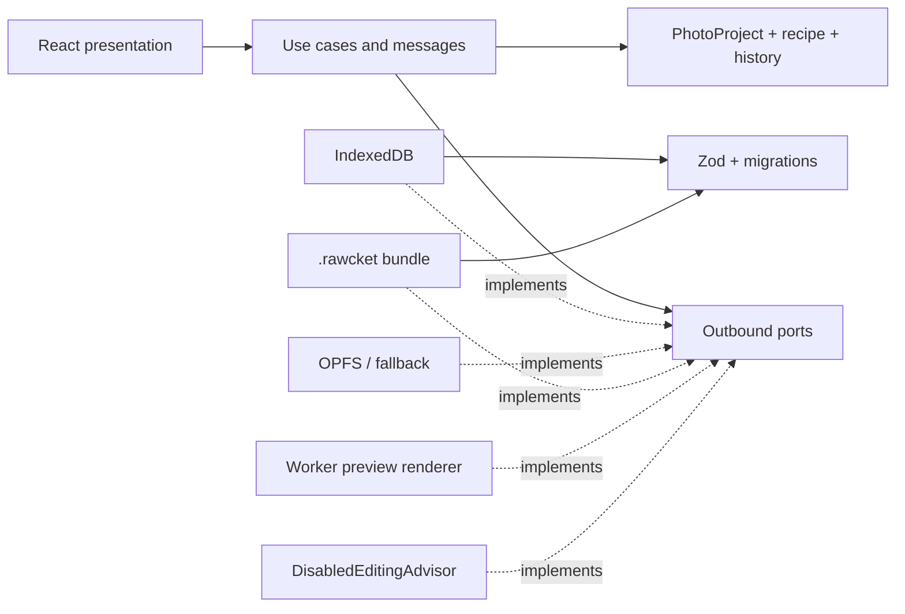
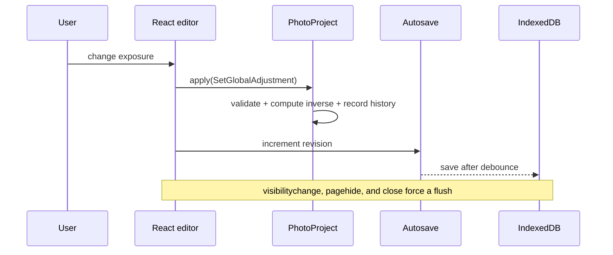

# RAWcket architecture

## Map

Dependency arrows point toward the application and domain layers. The domain depends only on `@haskou/value-objects` and its own concepts.

## Aggregate

`PhotoProject` is the consistency boundary. It owns the name, original reference, metadata, `DevelopmentRecipe`, `EditHistory`, and `ProjectUiState`. Every editorial mutation passes through an `EditOperation`; the aggregate computes the inverse before recording history and emits a domain event.

`DevelopmentRecipe` contains:

- `GlobalAdjustments`: fourteen adjustments with concept-specific ranges and independent enabled state.
- `CurveSet`: RGB, R, G, B, and optional luminance; normalized points and validated interpolation.
- `ViewportTransform`: a fixed crop frame and reversible original-image transform.
- `MaskDefinition[]`: vector/semantic source definitions; rasters and embeddings are caches, never source of truth.

## Boundaries

- Zod validates JSON and persistence data before `fromPrimitives` hydration.
- Persistence mappers are the normal consumers of complete primitive serialization.
- OPFS is used only behind `SourceFileRepository`; IndexedDB is the fallback.
- `PreviewRenderer` isolates worker and image-pipeline concerns from React and the domain.
- `EditingAdvisor` can return only `EditOperation` proposals and never receives authority to mutate an aggregate.

## Save flow

## Preview flow

`RenderProjectPreview` accepts a validated application message. `WorkerPreviewRenderer` owns scheduling, cancellation, timeout, and source lookup. The worker decodes the source into an `OffscreenCanvas`, applies the complete versioned global recipe and tone-curve LUTs with `CpuPixelDeveloper`, and returns an encoded WebP preview. Future WebGPU, WebGL2, and RAW adapters must preserve this port contract.
